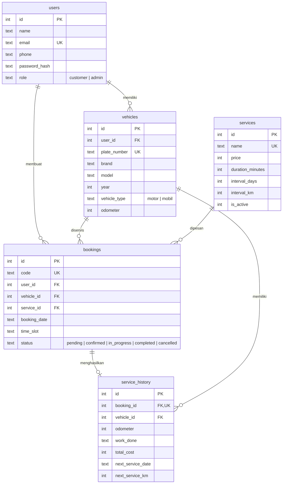

# Rancangan Basis Data BengkelKu (SQLite)

## Aturan bisnis utama

| Aturan | Penjelasan |
|---|---|
| Kuota slot | Maksimal `SLOT_CAPACITY` (default 2) booking aktif per tanggal dan jam; dicek di dalam transaksi |
| Hari libur | Booking pada hari Minggu dan tanggal lampau ditolak |
| Satu kendaraan | Tidak boleh punya dua booking aktif pada tanggal yang sama |
| Jenis layanan | Layanan motor tidak bisa dipesan untuk mobil (dan sebaliknya) |
| Alur status | pending → confirmed → in_progress → completed; pembatalan dari status aktif |
| Penyelesaian | Dalam satu transaksi: simpan riwayat, naikkan odometer, tandai booking selesai |
| Pengingat | Servis berikutnya = tanggal servis + `interval_days` atau kilometer + `interval_km`. `overdue` bila lewat, `soon` bila ≤ 14 hari atau ≤ 300 km |
| Hapus layanan | Layanan yang pernah dibooking dinonaktifkan agar riwayat tetap utuh |
